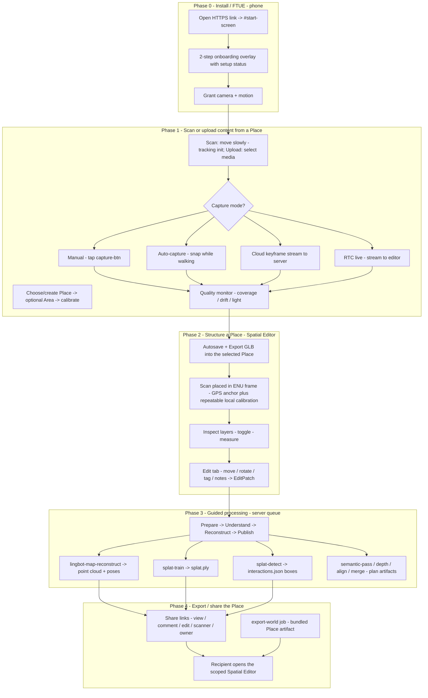
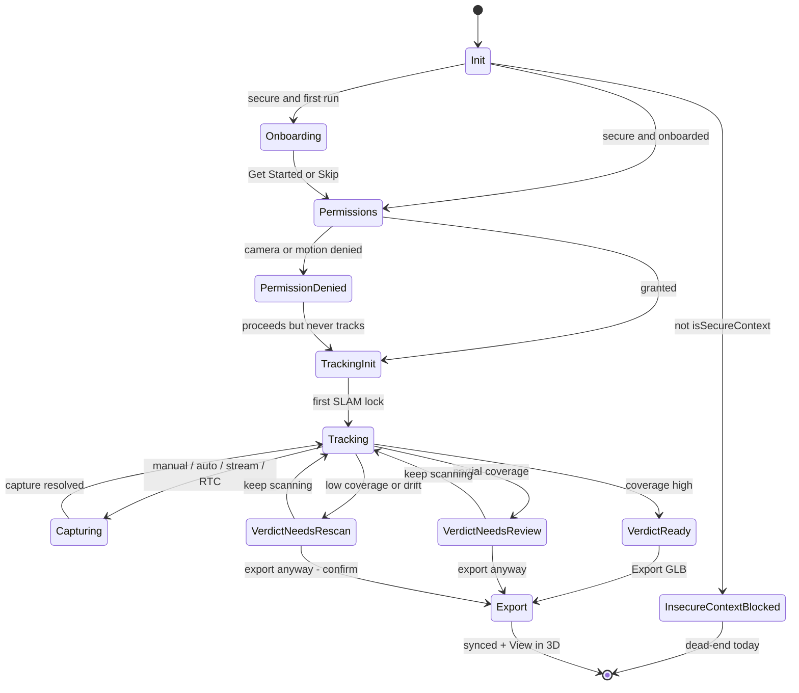

# UX Flow & FTUE Spec — CI-Spatial

> Design doc for contributors and designers. Describes how the everyday-user experience *should* flow, grounded in what exists in the code today. IDs, labels, and copy quoted here are verified against the tree at HEAD. Where something is a recommendation rather than current behavior, it is marked **[proposed]**.

**Related docs:** [README.md](../README.md) · [../architecture.md](../architecture.md) (canonical system design) · [UI_MANUAL.md](./UI_MANUAL.md) (exhaustive control catalog) · [../roadmap.md](../roadmap.md) (timelines / shipped-vs-planned)

This doc sits between ../architecture.md (the engineer's system sequence) and UI_MANUAL.md (the surface-by-surface control reference). It owns the *narrative*: the first-time journey, the mental model of the four capture pipelines, and the FTUE improvement backlog.

> **Current product vocabulary:** the user starts with a **Place**, may choose
> an **Area** such as a room or floor, then creates or uploads a **Scan**. The
> desktop destination is the **Companion Scan Spatial Editor** at `/editor`.
> See [PLACE_SCAN_DESIGN.md](PLACE_SCAN_DESIGN.md) for the canonical contract;
> legacy `WorldProject` language in implementation details refers to the
> compatible ENU scene record, not a separate user concept.

**📸 Screenshot gallery:** [ui-flow/](./ui-flow/) shows mobile + desktop screenshots of every flow below, generated automatically from the running app by [`tests/mock-ui-mobile.spec.ts`](../../tests/mock-ui-mobile.spec.ts) and [`tests/mock-ui-desktop.spec.ts`](../../tests/mock-ui-desktop.spec.ts). Representative shots are embedded per phase in §4.

---

## 1. Purpose & the everyday-user persona

### Who this is for

The **everyday user** is a non-expert who owns a place — a home, a workshop, a rental, a small shop — and wants to **digitize it into a private, structured, explorable map they control**. They are not a 3D artist, a photogrammetry hobbyist, or a SLAM engineer. They will not read tooltips, will not know what "ENU" or "gaussian splat" means, and will judge the product by one question: *"Did I capture enough, and can I go look at it?"*

Their intent is concrete:

- Walk through a room with their phone and have it "understand" the space.
- End up with something they can open later, explore in 3D, label, and share with a specific person (a contractor, an insurer, a family member) — without it being public.
- Do all of this without learning a pipeline.

Everything in this doc is measured against that persona. Jargon, hidden verdicts, and dead-end developer copy are treated as bugs, not details.

### What a "4D map" is (one paragraph)

A **4D map** in CI-Spatial is a `WorldProject` (`src/world/types.ts`): an anchored spatial container living in a single `LocalFrame` of type `ENU_Y_UP` — units in **meters**, axes **x = east, y = up, z = north**, anchored at an `originGeoPose` (lat/lng/altitude/bearing). It holds one or more `ScanManifest`s, each carrying typed **layers** — `points`, `mesh`, `floor`, `detections`, `labels`, `cameraPath`, `cameraFrustums`, `rgbFrames`, `depth`, `splat`, `semanticMasks` — so geometry, semantics, and provenance are addressable separately instead of fused into one flat mesh (that is the *structured* part). The **4th dimension is time**: it does not live in a single mesh but in the per-frame observation stream (`FrameObservation.timestamp` + pose/intrinsics/frustum — the camera's path through the space over capture time), in each scan's `capturedAt`, and in the append-only `EditPatch[]` edit history (every patch stamped `createdAt`). Because of that time axis, one world can hold **multiple scans of the same place captured at different moments** and replay the camera trajectory — the map is a time-series of posed observations composed into one anchored frame, not a static snapshot.

---

## 2. End-to-end journey map

Five phases. The first decision is always the **Place** (and, when useful, an
**Area**). Phases 0–1 happen on the phone through **Scan a Place** or **Upload
Content from a Place**. Phases 2–4 happen in the **Companion Scan Spatial
Editor** (`/editor`, implemented by `viewer.html`) plus the async server job
queue.

---

## 3. FTUE spec

### 3.1 Current onboarding (verified)

The first painted, interactive surface for a first-time user is the **onboarding overlay** (`#onboarding-overlay`, z-index 25) stacked on top of `#start-screen` (z-index 20). It is gated on the `localStorage` key **`companion-scan-onboarded`** (constant `ONBOARD_KEY`) and shows only when `!skipOnboarding && !localStorage.getItem(ONBOARD_KEY)`.

The two steps, quoted verbatim from `index.html`:

| Step | Icon | Title (`.onboard-title`) | Description (`.onboard-desc`) |
|---|---|---|---|
| 0 | camera | **Allow camera & motion** | "We use the camera to see the room, and motion sensors to know where you are standing. Tap Allow when your phone asks." |
| 1 | refresh | **Walk slowly** | "Move steadily and keep the camera up. Moving fast loses tracking. Coverage fills in as you go." Below it, three setup rows from `src/ui/ftue-status.ts`: Companion Memory, Model and Sign-in. When none of them answers, one Server row replaces them. See [First-run setup status](../../README.md#first-run-setup-status-and-settings). |

**Controls:** `#onboard-next-btn` (label flips to **`Get Started`** on the last step), two `.onboard-dot` progress dots, and `#onboard-skip` (**`Skip`**, a 44 px touch target). The overlay is a `role="dialog"`. On finish or skip, `finish()` writes `localStorage['companion-scan-onboarded'] = '1'` and hides the overlay.

**Skip paths:** `skipOnboarding = searchParams.has('mock') || searchParams.get('onboarding') === '0'`. So **`?onboarding=0`** or **any `?mock`** value bypasses the overlay entirely (`?mock=webxr` additionally installs the iwer WebXR emulation runtime).

**Re-entry:** the `#help-btn` (`?`, top-right, revealed after onboarding resolves) re-plays the overlay from step 0.

**Place step:** after the onboarding overlay resolves and before the scanner can open, `#place-sheet` identifies the current place from geolocation. It lists saved places within 100 m, one row per named place even when several share coordinates. `New place` lets the user accept the current fix or edit latitude/longitude and save a new project; selecting an existing row reuses that project. `Decide later` keeps the scan unassigned.

**Permission timing:** after onboarding and place selection resolve, the flow blocks on a `Start AR` click. Inside that click handler, *before any await*, it synchronously calls `DeviceOrientationEvent.requestPermission()` / `DeviceMotionEvent.requestPermission()` (the iOS 13+ motion prompt). The **camera** prompt fires slightly later, inside `provider.start(canvas)`.

**Readiness:** that permission call cannot be buffered and replayed later — it must sit in a real, await-free gesture handler — so the handler *is* the tap, and the only question is how early it can exist. It is attached at the top of `main()` (section 0), before the IndexedDB stores and the inference router's model load, none of which the button needs. A tap during boot is therefore honoured: it dismisses the start screen, requests motion permission inside the genuine gesture, and AR starts when section 5 is reached. `#start-ar-btn` still ships `disabled aria-busy="true"` with a `Preparing…` line in the static markup, and `setStartButtonState('ready')` clears it — that now covers only the ~50 ms until section 0 runs, plus the case where the bundle never loads at all, where staying disabled is the honest state. The same helper puts the card into a terminal `unavailable` state on the boot paths that give up (insecure context, no AR runtime, a crash in `main()`).

Because an early tap removes the start screen, `showArHelp()` — whose `#ar-help` element lives inside it — falls back to `#permission-error-banner` (a sibling that survives) when the screen is already gone, so "no AR runtime" cannot end as a blank screen.

### 3.2 Prioritized FTUE improvements

Ordered by value to the everyday user. Each is grounded in a specific, verified gap.

1. **Surface the completion verdict + a Done/Finish affordance on the phone (highest value).**
   The quality monitor already computes a verdict — `ScanQualitySummary.status` is `ready` / `needs-review` / `needs-rescan` plus a `recommendations[]` array (`quality-monitor.ts`). But it is **only written into the GLB and shown in the Spatial Editor** — never rendered on the phone. The everyday user's core question ("do I have enough?") is answerable in code but invisible where it matters.
   → Render `qualityMonitor.summary(...)` as a status chip in the HUD (`✓ Ready to export` / `Review recommended` / `Keep scanning`) with the top recommendation, and add a **`Done / Finish scan`** control near `#capture-btn` that opens the panel scrolled to Export. Make "finished" a real, visible state.

2. **Fix the help-button onboarding-key leak.**
   `#help-btn` currently **deletes** `companion-scan-onboarded` to replay and only rewrites it if the user reaches the last step. Close the app mid-replay and the key stays deleted → **full FTUE re-triggers on next launch**. It also binds a fresh advance handler on every tap without removing the prior ones, so repeated taps stack duplicate handlers and `Next` jumps multiple steps.
   → Drive replay from a parameter (do not delete the key); restore the key unconditionally on dismiss; bind the advance listener exactly once.

3. **Humanize permission + secure-context failures.**
   Motion/camera denial is caught with only `console.warn` — the user proceeds into a session that never tracks, seeing `Move camera to initialise tracking…` forever with no explanation. And the insecure-context bail shows developer copy (`HTTPS required — … run: tailscale cert <host>`) with a dead greyed `Start AR` button.
   → Replace silent denial with a persistent, OS-specific banner ("Enable in Settings → Safari → Motion & Orientation", plus camera re-enable steps). Replace the insecure-context copy with a human message ("This page must be opened over a secure https link — ask for the correct link"); keep the `tailscale` hint in the console only.

4. **Disambiguate the three capture modes.**
   Manual (`#capture-btn`), auto-capture (`📷 #auto-capture-btn`), and cloud keyframe streaming (`☁️ #stream-btn`) are three different data pipelines whose only differentiation is `title` tooltips that never appear on touch. The capture button itself is a blank circle with no shutter glyph.
   → Add a one-time labelled coach-mark sequence using outcome language ("Auto-snap as you walk", "Send frames for 3D/splat reconstruction"); give `#capture-btn` a shutter glyph and a distinct recording state when auto-capture is active; fold streaming into onboarding step 1's copy (today it mentions only "tap the capture button").

5. **Group the action rail.**
   `#scanner-action-rail` interleaves scan-tools (`📷` auto-capture, `☰` panel, `☁️` stream) with *navigate-away* controls (`🥽` runtime switch, `🖥` Spatial Editor) in one undifferentiated emoji row. Tapping `🥽` or `🖥` performs a full navigation and silently abandons the live session.
   → Split into a scan-tools cluster and a nav cluster; add short labels or first-use coach-marks; guard `🥽`/`🖥` with a "leave scan?" confirm when the session has unsaved points.

6. **Close the loop after export.**
   After `Export GLB` the button reads `Exported` and the status is `Scan exported & synced ✓`, but nothing tells the user the scan is now openable in the viewer (and autosave already uploaded it silently).
   → On successful export, surface a **`View in 3D →`** link (reuse the video-upload `#upload-video-open` pattern). Gate *manual* export behind a confirm when `status === 'needs-rescan'`, surfacing the recommendations.

### 3.3 Proposed improved onboarding step list **[proposed]**

Rework the overlay to teach outcomes and set expectations for the four capture modes and the "you'll know when you're done" verdict:

| Step | Working title | Intent |
|---|---|---|
| 0 | **Allow camera & motion** | Same permission ask, but preview the OS prompts and pre-empt denial ("if you tap Don't Allow, tracking won't work — you can re-enable in Settings"). |
| 1 | **Sweep the room slowly** | Animated sweep hint; explain the live point cloud and that moving too fast loses tracking. |
| 2 | **Three ways to capture** | Tap to identify objects · Auto-snap as you walk · Send frames for 3D/splat reconstruction. One line each, outcome language. |
| 3 | **We'll tell you when you have enough** | Introduce the coverage bar and the Ready / Review / Keep-scanning verdict so it isn't a surprise mid-scan. |
| 4 | **Finish & view in 3D** | Export a `.glb`, then open the desktop world to explore, label, and share. End on the `View in 3D →` promise. |

---

## 4. Per-phase flow detail

### Phase 0 — Install / FTUE (phone)

 

**User goal:** open the link, understand what the app does, grant access, and get to scanning without friction.

**Screens/controls today:**
- `#start-screen` — brand eyebrow `Companion Intelligence`, title **`Companion Scan`**, subtitle **`Private spatial memory for places you own.`**, primary CTA **`Start AR`** (`#start-ar-btn`), quiet secondary **`or upload a walkthrough video`** (`#upload-video-btn` → hidden `#upload-video-input`), and a conditional `#ar-help` block (shown only when no AR runtime is found).
- `#onboarding-overlay` — the 2 steps in §3.1.
- Permission prompts — iOS motion (from the `Start AR` click), then camera (from `provider.start`).

**Guidance signals:** `#status-text` walks `Press Start AR to begin` → `Move camera to initialise tracking…`. On first SLAM lock it flips once to `Tracking — tap to capture`. `#start-ar-btn` is enabled well *before* the status reaches `Press Start AR to begin` — it goes live at the top of the boot, and that status is only the prompt shown if the user hasn't already tapped. See **Readiness** in §3.1.

**Gaps:**
- Insecure-context bail shows developer copy + a dead greyed button; `main()` returns before onboarding ever runs.
- Motion/camera denial is `console.warn`-only — the user lands in a session that never tracks with no explanation.

**Recommended improvements:** items 2, 3 in §3.2; the reworked step list in §3.3.

---

### Phase 1 — Scan a room (phone)

 

**User goal:** capture the space well enough to be worth exploring later, and know when that's true.

The everyday user must understand there are **four distinct capture pipelines**, which today look nearly identical:

| Mode | Control | What it actually does |
|---|---|---|
| **Manual capture** | `#capture-btn` (center circle) | On tap: `Capturing next frame…` → `Analysing…` → `N objects detected`; runs on-device (or WebGPU/server) inference, spawns AR pins, shows the `#infer-dialog` "Latest scan" card. |
| **Auto-capture** | `📷 #auto-capture-btn` (+`#auto-capture-count`) | Pose-delta triggered snapshots as you walk. Status `Auto-capture ON — move camera to scan`; button gets `.active`. |
| **Cloud keyframe streaming** | `☁️ #stream-btn` (+`#stream-count`) | Streams RGB keyframes to the server, seeding `sessionId`-keyed reconstruction jobs (lingbot-map, splat-train need this). |
| **RTC live** | `#rtc-stream-btn` (`LIVE · tap to stop`, hidden until active) / `📡 Start Live Stream` in the panel | Live WebRTC stream to the desktop editor's Live Feed — the editor grows a live point cloud + moving frustum in real time. |

**Screens/controls today:**
- Live HUD: `#capture-btn`, `#scanner-action-rail` (`🥽 #xr-mode-link` · `☰ #panel-toggle` · `🖥 #viewer-link` · `☁️ #stream-btn` · `📷 #auto-capture-btn` · `🕒 #history-btn`), `#help-btn`.
- `#quality-overlay`: coverage bar (`Cov` + `#quality-coverage-text`), drift/light/reflection badges, `#quality-missing` ("N areas missing").
- Top-left HUD: compass ring, `#status-text`, `#scan-stats` ("N pts"), `#geo-chip` (`Locating…` / coords), `#autosave-status`.
- `#infer-dialog` "Latest scan" card (auto-shows per capture, auto-dismisses ~4 s).
- `#side-panel` (`☰`): header **`Review & Export`**, step strip `Scan · Review · Edit · Export`, per-object cards, footer actions (`Export GLB`, `Export Summary`, `Server Processing`: `🗺 Generate Floor Plan`, `✍ Scene Description`, `📊 Object Report`, `Clear session`, `📡 Start Live Stream`, `AI Engine` toggle `🖥 Server` / `⚡ WebGPU`).
- `#history-drawer` (`🕒`): `Scan Memory`, Leaflet geomap, session cards.

**Guidance signals:** coverage color (green ≥80 / amber ≥50 / red) + `coverageLabel()` text (`Low — keep scanning` / `Partial — scan more surfaces` / `Good` / `Excellent`); drift badges (`⚡ Fast` / `↗ Speed`) + one-shot `⚠ Moving too fast — slow down`; `🌑 Low light` / `✦ Refl` badges; `N areas missing` from a 4×4 floor-grid density check; autosave cycle (`Autosave queued` → `Saving scan…` → `Autosaved <name> · HH:MM`).

**Gaps:**
- The **verdict** (`ready` / `needs-review` / `needs-rescan` + `recommendations[]`) is never shown on the phone.
- No "done/finish" affordance; export is buried in the side panel.
- The four capture pipelines are visually indistinct; the capture button is a blank circle.
- `🥽` / `🖥` navigate away mid-session without confirmation.
- WebGPU vs server inference is **opt-in** via `localStorage['infer-mode']` (the `AI Engine` toggle) — not auto-detected. Server-side is the default.
- `needs-rescan` scans autosave and upload silently anyway; the user only learns the verdict later on desktop.

**Note on inference (for accuracy):** default inference is `INFERENCE_MODE=ollama` with `OLLAMA_MODEL=qwen3-vl:4b`. `onnx` mode runs `LiquidAI/LFM2.5-VL-1.6B-ONNX`; `mock` mode is the deterministic colour-blob CV engine used in tests. See [../architecture.md](../architecture.md) for the full inference explainer.

**Recommended improvements:** items 1, 4, 5, 6 in §3.2; an animated sweep hint before first SLAM lock.

---

### Phase 2 — Structure into the 4D map (desktop editor)

**User goal:** open the world, see scans placed correctly, and organize/label/compose them.

**Where:** the **Companion Scan Spatial Editor** at `/editor?project=<id>` (or `?world=<slug>`), implemented by `viewer.html` and `src/viewer/viewer.ts`. `?project=` opens the Place's own world (`project-<id>`), and `?token=` is the share link's role. The headset editor (`xr-world.html`) opens the same world by the same rule (`src/viewer/world-rules.ts`).

**Screens/controls today:**
- **Top toolbar.**
  - The Place's name (`#toolbar-project-name`).
  - Three counts:
    - scans (`#toolbar-scan-count`);
    - layers (`#toolbar-layer-count`): how many of the Scene layers rows have something to show in this Place;
    - jobs (`#toolbar-job-count`): finished out of listed, with a progress bar (`#toolbar-job-fill`).
  - The **View** menu (`#view-menu`):
    - Show all and Hide all, and six layer toggles: Camera trail, Scanned images & frustums, Detected objects, Hit points, Planes, and Splats & photogrammetry. A layer the Place has no data for is disabled and says why (`src/viewer/view-menu.ts`);
    - Filter objects (`#view-filter-objects`, e.g. `chair, desk  ·  -wall`);
    - Render mode (`#view-mode-select`: Solid, Points, Wireframe, Semantic);
    - toggles for GIS map (`#view-toggle-map`), Ground grid, Tags and Calibration anchors.
  - **Live** (`#btn-livefeed`), only in a build with `VITE_ENABLE_WEBRTC_LIVE=true`.
  - The **Navigate** menu (`#workspace-menu`):
    - **Scan a Place** (`#scan-place-link`). In the desktop app it reads **Add media to a Place**, because a computer can upload a walkthrough but cannot walk a room.
    - The WebXR scanner, which the native shells drop.
    - **Scan with a phone**: the Place's scanner link, with its QR on a click, when the Place issues one.
    - The account chip.
    - Inside a shell, also the Scan server and Legal notices.
  - The **Share** menu.
- **Left rail tabs** (`.sidebar-tab`): **Project, Scans, Things, Layers, Edit**, and **Places**, hidden unless the build sets `VITE_ENABLE_PLACE_COMPOSER=true`.
  - The Project, Layers and Edit panels open in the right drawer (`#details-drawer`).
  - While Layers is open, the Map Quality headline and the Scene layers list sit in the rail under the tabs (`#sidebar-layer-info`).
  - Each drawer collapses and reopens from a tab that stays outside it (`src/viewer/editor-layout.ts`).
  - **Scans** (`#tab-scans`):
    - The **timeline** (`#timeline-scrubber`). It has two handles over the Place's capture sessions and shows only when there is more than one. The scans, Things and Items tree outside the range are hidden.
    - The frame banner (`#frame-banner`).
    - The scan list. Each `.scan-item` has a visibility checkbox and the scan's name.
    - A meta line (`src/viewer/scan-calibration-chip.ts`): the calibration chip, or the GPS accuracy (or `manual align`) for a scan with no calibration, plus what the calibration did not check.
    - The frame chip (`src/viewer/frame-banner.ts`: "previous reference", "not in Place frame" or "frame not recorded"). A scan in a Place frame made with another method than the Place's own also says "Different frame from this Place". The two chips ask one predicate, so a row never shows both.
    - Tracking notes, and `.scan-status`.
    - Selecting a scan frames it, attaches the transform gizmo and fills the per-scan panels.
  - **Things** (`#tab-things`):
    - search, label and scan filters;
    - each row focuses the Thing in the scene;
    - each row has Relabel (Save, or Clear back to the AI label).
  - **Items** (right drawer, `#details-items`), for the Scans and Things tabs:
    - the Place → building → floor → room → scan outliner, with each scan's Things, or a note saying why a scan has none;
    - **Review comments** for the Place or the selected scan.
  - **Project** (`#tab-world`, right drawer):
    - the Place hierarchy editor (type, names, **Save Place structure**);
    - the Places at this address and Other Places switcher;
    - **Guided Processing** (Prepare, Understand, Reconstruct, Publish);
    - **World export** (Phase 4);
    - **Alignment checks** (place-register proposals: Show, Apply);
    - the **Advanced queue** (Phase 3).
  - **Layers** (right drawer):
    - **Map Quality**: a Preview → Reconstructed → Photoreal stepper, the reconstruction verdict and the processing line;
    - **Scene layers** (`#layer-list`);
    - **Previous reference**;
    - **LingBot-Map**;
    - **SenseNova Vision**;
    - **Placed objects**;
    - **Splat tools**.
  - **Edit** (right drawer):
    - the save line;
    - **Hidden objects**: every object a Hide patch took out of the scene, each with **Show**, which saves a `visible: true` patch. A hidden object cannot be clicked, so this list is the way back.
    - With a selection:
      - **Selected Object**;
      - **Transform**: Move, Rotate, Scale, and **Save Transform**, which writes an `EditPatch`;
      - for a whole scan, **Place precisely** (nudges and numeric offsets, snap, Discard changes, Reset to calibrated, Undo last save, Fix size) and **Compare** (tints, see-through);
      - **Semantic Tag** chips (`SEMANTIC_TAGS`);
      - **Notes**;
      - **Visibility**: **Hide Object**, saved as a patch.
- **Scene layers rows:**
  - Listed: Point cloud, Meshes, Floors, Detections, Labels, Camera path, Camera frustums, RGB frames, 4D person and Calibration anchors.
  - Not listed:
    - Depth and Semantic masks, because nothing draws them yet;
    - the static Gaussian splat, which has its controls in Splat tools.
  - A row's count is what the scans' manifests report, else how many objects of that layer are loaded. A camera layer with no reported count and nothing drawn says `no frames`, and any other such layer says `none`.
  - The **4D person** row is the switch for a person capture's splat sequence. A hidden sequence is paused.
- **One switch per layer.** These all write the same visibility, so they always agree:
  - the HUD's **Cloud**, **Labels** and **Bounds** buttons;
  - the Views toggles;
  - the Scene layers rows.

  Detection bounds start hidden.
- **Viewport HUD:**
  - bottom right: Reset, Cloud, Labels, Bounds, and Save Tags, which posts every unsaved tag and note;
  - top: the compass, the scale bar, **Measure** and the coordinate readout;
  - the info line;
  - the floating inspector, on an object click.
- **Measure** (`#btn-measure`) draws a line between two clicks on scan geometry and labels its length with an `m`. The `m` is real only on GLB scan geometry (`src/viewer/measure.ts`):
  - LingBot-Map clouds have no recovered scale;
  - a splat cannot be clicked;
  - the splat renderer's quad at the origin can be.

**How placement works (verified):**
- **The declared frame.** Every world file declares `{ type:'ENU_Y_UP', units:'meters', axes:{x:'east', y:'up', z:'north'} }`, anchored at `originGeoPose`: the GPS fix of a located scan, taken when the world file was made (`inferWorldOrigin`, newest upload first), not the Place's landmark.
- **Calibrated scans** are placed by their stored calibration (`projectTransform`) in their Place's frame.
  - A two-point frame's +Z is its landmark → marker baseline.
  - A one-point frame's +Z is north and its +X west.
  - Neither is the declared (east, up, north), so the compass and the coordinate readout are only approximate in a Place world.
- **GPS scans with no calibration** are placed at their east/up/north offset (`geoToEnu`) and turned by the phone's compass heading when the scan was exported.
  - That is a rotation alone into a left-handed frame, so the scan is mirrored east-west against the GPS layout.
  - The heading is not the bearing of the session's own axis.
  - `src/world/enu.ts` sets this out. Fixing it is a pending owner decision (the right-handed, z-south scene).
- **No-GPS scans** ("manual align") land on a fallback 3 m grid, six to a row. Video-ingest scans get the same grid placement.
- **Manual alignment** is the gizmo and **Save Transform** (a `scope: 'scan'` `EditPatch`). A reload re-applies it, and **Undo last save** takes the last one back.

**Guidance signals:**
- the scan list's calibration, frame and coverage lines;
- the compass, scale bar and coordinate readout, which follow the orbit camera;
- the layer rows' counts and sources;
- the toolbar's counts.

**Gaps:**
- There is no "1. Import 2. Align 3. Reconstruct 4. Export" sequence telling a non-expert what to do next beyond the Guided Processing steps.
- Heavy jargon remains ("ENU", "Extract layers", "Merge points", "semantic pass").
- `align-scan` and `merge-points` *look* like automated registration but are placeholders.
  - They report `completed`, and the job list prints their `No-op:` result.
  - The guided Prepare and Understand steps say in their own copy that indexing, layer extraction and semantic analysis are not built yet.
  - Real alignment today is the gizmo and the Alignment checks' Apply.
- The timeline narrows the scans shown by capture time. There is no before/after diff of two visits.
- The editor has no keyboard shortcuts.

**Where "4D" (time) is visible today:**
- the timeline;
- the **Camera path**, **Camera frustums** and **RGB frames** layers, drawn from a scan's frame set and only from it: a scan with no usable frames draws no trail;
- the **4D person** layer (`splat4d`), a person capture's splat sequence on a loop;
- the **Live** feed, in a build that enables it: while someone walks the room, the editor grows a live point cloud and a moving device frustum.

The two senses of "4D" are distinguished in ADR 0006.

**Recommended improvements:**
- a lightweight guided sequence for first-time worlds;
- explain jobs at the point of use;
- visually distinguish placeholder jobs from real ones;
- a scan-diff view as a later iteration.

---

### Phase 3 — Reconstruction / detection jobs (server queue)

**User goal:** turn raw scans into richer artifacts (dense point clouds, splats, detected objects) without understanding the pipeline.

**One queue, two UI surfaces — do not conflate them:**
- **The Project tab.** **Guided Processing** shows the editor-driven stages: preparation, understanding, reconstruction and publishing. The **Advanced queue** is for expert use.
- **`optimize-scan`**, the GLB optimizer, writes `.opt.glb` / `.lodN.glb` / `.manifest.json`. This is where **progressive LOD** comes from.
  - It runs through the *same* WorldJob queue (`docs/adr/0003-merged-job-system.md`).
  - It keeps its own surface: transient scan-status text ("Optimization queued…" / "Optimizing (quantize/draco/LODs)…").
  - It is filtered *out* of the job list, so upload bursts cannot crowd out the reconstruction jobs.

**World job types (23):** the `WorldJobType` union in `src/world/types.ts`; [`../architecture.md`](../architecture.md) § World Job Types & Processing describes them.
- **The Advanced queue's `#job-type` select** offers 13 of them (`POST /worlds/:slug/jobs`): `ingest`, `extract-layers`, `merge-points`, `semantic-pass`, `depth-reconstruct`, `thing-correspondence`, `lingbot-map-reconstruct`, `splat-train`, `splat-detect`, `splat-finish`, `sensenova-vision`, `export-world` and `place-register`.
  - A job that reads one scan needs a selected scan (`SCAN_REQUIRED_JOB_TYPES`, `src/world/job-types.ts`). The line under the select says whether the chosen job runs on the selected scan or the whole Place, and **Queue Job** refuses a scan-backed job with no scan selected.
- **Other surfaces:**
  - Splat tools queue `splat-train` and `splat-detect` with their own payload.
  - The SenseNova panel queues `sensenova-vision`.
  - The Publish step queues `memory-push` and `export-world`.
  - `optimize-scan` runs on upload.
- **The rest** are queued by the server or reached through the API.
- **Not this queue:** the **sync `/process-scan` actions** (`object-count`, `scene-description`, `floor-plan`) are a different route and pipeline, on the phone panel's `Server Processing` block.

**Screens/controls today:**
- **Guided Processing** (Project tab): each stage queues its jobs for the selected scan.
- **Advanced queue** (Project tab): `#job-type`, the job-type line (`#job-type-hint`), `#btn-queue-job` and `#job-list`, the newest eight with each job's result sentence.
- **Map Quality** (Layers): the tier stepper and the reconstruction verdict.
  - No line for a scan whose poses never went through the solver.
  - A "not known" line when the server does not serve the solver's report, or the read fails, so it is not mistaken for "never ran" (`src/viewer/artifact-read.ts`).
- **SenseNova Vision** (Layers):
  - the task (`#sensenova-task`), optional labels and **Run SenseNova**;
  - the panel shows the selected scan's latest SenseNova job: queued, running, failed, skipped (with the runtime hint), or completed with its result and the names of its output files;
  - the files stay on the server, which has no route to open them from the editor yet.
- **Placed objects** (Layers): what panoptic-lift placed in the scan, with firm and unsure markers.
  - It says "nothing has looked for things" only when the lift has not run.
  - When the server does not serve the record, or the read fails, it says that is not known.
- **Splat tools** (Layers, `#splat-toolbox-section`):
  - `#btn-splat-train` "Train splat";
  - "Download .ply", and "Download .sog" once splat-finish has run;
  - `#splat-layer-toggle` "Show trained splat";
  - **Detect objects**: `#splat-detect-prompt` (placeholder `sofa, chair, table, tv, lamp`), `#btn-splat-detect` "Detect" and `#splat-detect-toggle` "Show detected object boxes", which shows and hides the boxes' captions with them;
  - **External splat**: a URL or a file (`.ply,.spz,.splat,.ksplat,.sog,.zip`).

**What each job writes (✅ = real file when the worker is wired; ⚠ = plan/placeholder metadata only):**

| Job | Real? | Artifact / where it surfaces |
|---|---|---|
| `ingest` | ⚠ | `ingest-report`; job list only |
| `extract-layers` | ⚠ | `layer-manifest`; job list only |
| `align-scan` | ⚠ | `alignment-report` (`method: local-placeholder-open3d-ready`, labelled a placeholder); moves nothing and sets no status; the result says `No-op:`; not offered in the editor |
| `merge-points` | ⚠ | `merge-points-report`; job list only |
| `semantic-pass` | ⚠ | `semantic-report`; job list only |
| `depth-reconstruct` | ⚠ | `depth-plan`; job list only |
| `lingbot-map-reconstruct` | ✅ | `lingbot-map.manifest.json` + `.point-cloud.ply` + `.poses.json` + `.lingbot.glb`; **Layers → LingBot-Map** |
| `splat-train` | ✅ | `.splat.ply` (+ `.compressed.ply` + manifest); **Splat tools**: "Trained splat ready — N gaussians", toggle, Download .ply |
| `splat-detect` | ✅ | `.interactions.json` (+ manifest); **Splat tools → Detect objects**; 3D boxes and their captions in the viewport |
| `splat-finish` | ✅ | `.sog` + `.compressed.ply` (+ manifest); auto-chains after `splat-train` unless `SPLAT_FINISH_AUTO=0`; Download .sog |
| `sensenova-vision` | ✅ | output files under the server's scan store, listed by name in the **SenseNova Vision** panel; a skip names the runtime to install |
| `memory-push` | ✅ | `memory-event` (a `capture.scan` push to CI-Server); job list only — inert until the Companion Hub connects Companion Memory (it sets `CI_SERVER_URL` and `CI_SERVER_TOKEN`), or both are set by hand. See [Companion Hub](../operations/COMPANION_HUB.md) |
| `export-world` | ✅ | `<slug>.world.glb` (a `world-glb` artifact): every scan's GLB under its `localToWorld`, plus one node per Thing with its tag in `extras`; **Project → World export** links it |
| `place-register` | ✅ | `place-register-proposal`: how a scan's walls line up with the Place's other calibrated scans, and the move that would line them up better; **Project → Alignment checks** (Show, Apply). Queued when a second calibrated scan is uploaded to a Place, or from the Advanced queue. It never moves a scan and never sets `aligned`; Apply writes an ordinary scan patch with its provenance. See [`../pipelines/place-register.md`](../pipelines/place-register.md) |
| `optimize-scan` | ✅ | `.opt.glb` + `.lodN.glb` + `.manifest.json`; the per-scan status line and progressive LOD loading — deliberately **not** in the job list |

**Guidance signals:**
- On the `/events` WebSocket, a `world-job-update` refreshes the job list.
- A completed LingBot-Map, splat or panoptic-lift job re-reads the scan's layer, so Layers updates without a reload.
- Failure reasons (`jobFailureReason`) are sentences.
- A missing GPU tool writes a **`skipped` manifest with a remediation hint**, and the job still shows `completed`.

**Gaps:**
- **Planned-vs-real is half visible.** Six job types (`ingest`, `extract-layers`, `align-scan`, `merge-points`, `semantic-pass`, `depth-reconstruct`) write only plan/placeholder metadata and still report `completed`. Their result starts `No-op:`, and the job list prints it, but the status word is the same.
- **When-to-run-which is only partly in the UI.** The Advanced queue says when a job needs a scan, but not its other prerequisites:
  - `splat-detect` needs a trained splat first;
  - `splat-train` needs a keyframe session.
- **Job outputs are not linked from the job list.** They surface in the Layers panels, the World export section and the download links.

**Recommended improvements:**
- badge placeholder jobs distinctly from real ones;
- annotate jobs whose prerequisites are not met;
- link artifacts from the job list.

---

### Phase 4 — Export / share the world

**User goal:** hand a specific person a private, explorable copy — scoped to what they should see.

**Screens/controls today:**
- **Share** (top bar, `#share-menu`): three entries, **view-only**, **comment** and **edit**, each copying the Place's link for that role, sourced from `/worlds/<slug>/share`. A role with no link for the caller is disabled and says "Coming soon", and the owner link is not listed. The scanner link is in the Navigate menu as **Scan with a phone**, with a QR that shows only on a click. Recipients open only the granted Place in the Spatial Editor.
- **Publish** (Project tab, `GUIDED_WORKFLOWS.publish` in `src/viewer/viewer.ts`) queues:
  - `memory-push`, which pushes the scan to Companion Memory;
  - `export-world`, which writes the Place's `.world.glb`.
- **World export** (Project tab, `#world-export-section`): once an `export-world` job has completed, **Download world GLB** links `GET /worlds/<slug>/export.glb`, carrying the page's world token, under that job's result sentence.

**Guidance signals:** the toolbar's scan, layer and job counts.

**Gaps:**
- On the **phone** side the loop doesn't close: after `Export GLB` there's no `View in 3D →` link back to the world.
- Each Share entry says in one line what its role can do, but not what it cannot.

**Recommended improvements:** add the phone-side `View in 3D →` (§3.2 item 6); show role capabilities inline, so an owner shares confidently.

---

## 5. Scanner state model

The mobile scanner's lifecycle, from load to a quality verdict and export. The verdict states (`ready` / `needs-review` / `needs-rescan`) are computed today but **not yet surfaced on the phone** — see §3.2 item 1.

---

## 6. Accessibility & mobile-ergonomics notes

Building on the merged accessibility/onboarding work:

- **Safe-area insets.** All fixed HUD chrome (`#scanner-action-rail`, `#capture-btn`, `#quality-overlay`, `#help-btn`, top-left status cluster) must respect `env(safe-area-inset-*)` so nothing hides behind notches, home indicators, or rounded corners. The capture button in particular sits low-center and must clear the home indicator on tall phones.
- **Tap targets.** `#capture-btn` is a large (~78 px) target — good. The action-rail emoji buttons are smaller and denser; keep each ≥ 44×44 px and add spacing between the scan-tools and nav clusters (§3.2 item 5) so users don't navigate away by mistake.
- **Reduced motion.** Any proposed animated cues (the sweep hint, the auto-capture recording pulse) must honor `prefers-reduced-motion: reduce` and degrade to a static equivalent.
- **Labels over glyphs.** Emoji-only controls (`🥽 ☰ 🖥 ☁️ 📷 🕒`) are opaque to screen readers and to sighted non-experts alike. Every control needs an accurate `aria-label` (the capture button already has `aria-label="Capture"`), and the highest-traffic ones should carry visible text or first-use coach-marks.
- **Status is announced.** `#status-text` carries the primary feedback loop; it should live in an `aria-live` region so tracking/capture/verdict changes are announced, not just painted.
- **Color is not the only signal.** The coverage bar and drift/light badges encode state in color (green/amber/red). Pair each with text (`coverageLabel()` already does) and an icon so color-blind users get the same verdict.
- **One-handed reach.** Primary actions (capture, done/finish, panel) should sit within thumb reach at the bottom; navigation-away controls can sit higher, reinforcing the scan-tools-vs-nav split.

---

## 7. Open questions / next design iterations

1. **Guided world flow.** Should the desktop editor gain an explicit, dismissible "Import → Align → Reconstruct → Export" wizard for first-time worlds, or stay a flat expert panel with better in-context hints? What's the right default for a non-expert vs a returning power user?
2. **Placeholder-vs-real legibility.** What's the clearest way to show that `align-scan` / `merge-points` currently record intent rather than produce artifacts — a badge, a disabled state, a "coming soon" tag — without lying about capability?
3. **Time navigation.** The data for a real 4D experience exists (`capturedAt`, per-frame timestamps, `EditPatch[]` history), and the editor's timeline (`#timeline-scrubber`) already narrows the scans by capture time. What's the next useful slice — a two-scan before/after toggle, a camera-path scrubber, or an edit-history timeline?
4. **Verdict-gated export.** Once the verdict is on the phone, how hard should `needs-rescan` gate export — a soft confirm, or a stronger nudge? How do we avoid nagging users who legitimately want a partial scan?
5. **Capture-mode defaults.** Should keyframe streaming be on by default (so reconstruction jobs "just work" later) or stay opt-in to save bandwidth? How do we teach the tradeoff without a wall of text?
6. **Job prerequisites in-UI.** Should the editor auto-chain dependent jobs (e.g. auto-run `lingbot-map-reconstruct` before `splat-train` for video-ingest scans) or just surface the ordering as guidance?
7. **Share confidence.** How do we communicate view/comment/edit/scanner/owner capability boundaries at the moment of sharing so an owner knows exactly what a recipient will and will not be able to do?

---

*See also: [../architecture.md](../architecture.md) · [README.md](../README.md) · [UI_MANUAL.md](./UI_MANUAL.md) · [../roadmap.md](../roadmap.md)*
